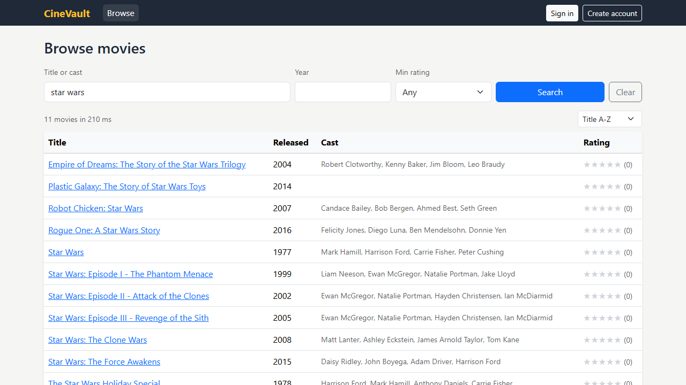
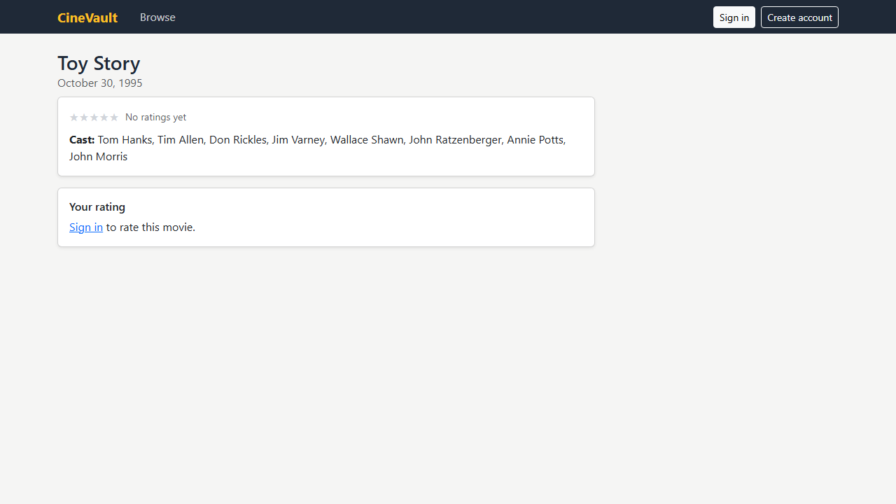

# CineVault

Movie catalog you can search, browse, and rate. A .NET 10 minimal API on SQLite with full-text search, and a React 19 web app.

License: Apache-2.0. Keep `LICENSE` and `NOTICE` if you fork it.
Author: Daniel Llano ([github.com/daniel-llano](https://github.com/daniel-llano))





## What it does

- Search about 39,000 titles by title or cast name. Search goes through a SQLite FTS5 index, so it stays fast.
- Filter by year and minimum rating, sort by title, release date, or rating.
- Members rate a movie from 1 to 5 stars. One rating per member per movie, and they can change or remove it.
- Admins add, edit, and delete movies. Editing a movie never touches its ratings.

## Layout

```
cinevault/
├── api/     ASP.NET Core minimal API, EF Core + SQLite, xUnit tests
├── web/     React + TypeScript (Vite), served by nginx in production
├── infra/   docker-compose for the API and the web app
└── e2e/     Playwright tests against the compose stack
```

## Run it

```bash
./scripts/run.sh        # or .\scripts\run.ps1
```

| What | Where |
|------|-------|
| Web app | http://localhost:5173 |
| API reference | http://localhost:5268/docs |

The first start imports `api/src/CineVault.Api/Data/movies.csv` and builds the search index. Sign in as `admin@cinevault.local` / `Admin@1234` to manage the catalog.

Without Docker:

```bash
dotnet run --project api/src/CineVault.Api   # http://localhost:5268, Development settings
cd web && npm install && npm run dev          # http://localhost:5173, proxies /api to the API
```

## API

| Method | Path | Who |
|--------|------|-----|
| GET | `/api/movies?q=&year=&minRating=&sort=&page=&pageSize=` | Anyone |
| GET | `/api/movies/{id}` | Anyone (includes `myRating` when signed in) |
| POST, PUT, DELETE | `/api/movies`, `/api/movies/{id}` | Admin |
| PUT, DELETE | `/api/movies/{id}/rating` | Signed-in members |
| POST | `/api/auth/register`, `/api/auth/login` | Anyone |
| GET | `/api/auth/me` | Signed-in members |
| GET | `/health/live`, `/health/ready` | Anyone |

`sort` is `Title`, `Newest`, `Oldest`, or `TopRated`. Errors are RFC 9457 problem details, and validation errors list each bad field.

## Configuration

| Key | Notes |
|-----|-------|
| `ConnectionStrings:CineVault` | SQLite file. The container keeps it in the `/data` volume |
| `Jwt:Secret` | Required, 32+ characters |
| `Jwt:AccessTokenMinutes` | Default 120 |
| `Catalog:ImportCsv` | CSV to load when the movies table is empty |
| `Bootstrap:AdminEmail`, `Bootstrap:AdminPassword` | Creates the first admin if it doesn't exist |
| `Cors:Origins` | Only needed when the web app is served from another origin |
| `EnableApiDocs` | Serves `/openapi/v1.json` and `/docs` outside Development |

In production the web container proxies `/api` to the API, so both live on one origin.

## Tests

```bash
./scripts/test.sh   # API integration tests on a temp SQLite file, web typecheck + Vitest + build
./scripts/e2e.sh    # Docker stack + Playwright
```

See [TESTING.md](TESTING.md).
